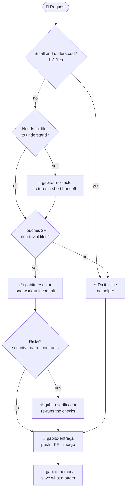

# User guide

The detailed reference for GabitoTL. The [README](../README.md) is the short tour; this guide keeps the full material.

## Contents

- [The installer screen (TUI)](#the-installer-screen-tui)
- [Windows setup and Manager](#windows-setup-and-manager)
- [Core concepts](#core-concepts)
- [Commands](#commands)
- [Authorship: no AI branding](#authorship-no-ai-branding)
- [Team memory](#team-memory) and [Changing the provider](#changing-the-provider)
- [Who is here](#who-is-here)
- [The Gabito persona](#the-gabito-persona): [Saving tokens](#saving-tokens), [Kiro](#kiro), [Chat modes](#chat-modes), [Persona language](#persona-language)
- [Skills](#skills)
- [Code index (optional)](#code-index-optional)
- [Migrating from Gentle-AI](#migrating-from-gentle-ai)
- [Delivery settings](#delivery-settings) and [Platforms and login](#platforms-and-login)
- [Project layout](#project-layout), [Security](#security), [Status and limitations](#status-and-limitations)

## The installer screen (TUI)

On a terminal, `gabitotl` and `gabitotl install` open a full-screen installer
(Bubble Tea, Lip Gloss, Huh) in Rioplatense Spanish (or English, see [Persona language](#persona-language)). It walks through:

1. what was detected (`✓` ready, `!` needs attention, `→` will be configured, `×` error);
2. what to do (migrate Gentle-AI, install without touching it, review details, quit);
3. "Tu memoria está segura" (reuse Engram, or go to shared team memory);
4. only the questions that cannot be detected (alone or with other people, commits and PRs), one at a time;
   for a team: "Memoria compartida (recomendado para equipos)" with two roles, host and client
   (see [Team memory](#team-memory)), and, if Engram has memory, import it, keep it as history
   or start empty;
5. which coding agents to configure (detected ones preselected; nothing is installed);
6. the plan (CREATE / MODIFY / PRESERVE / IMPORT / REMOVE AFTER VERIFY / NO ACTION), with the
   exact persona block that would be retired, and an `Aplicar` button;
7. live progress, then the result with a TIP (backup kept, `gabitotl cleanup`).

Quitting (`q`, `ctrl+c`) before applying changes nothing. `ctrl+c` while applying asks the
installer to roll back and waits for it, so the machine is never left half-applied; the
retirement of Gentle-AI is the point of no return and always finishes. It works in 80x24,
follows terminal resizes, and honors `NO_COLOR` (symbols, never color alone, carry the state).

The TUI opens only when stdin **and** stdout are terminals. `--no-tui`, `--yes`, `--dry-run`,
pipes and `migrate` keep the plain text flow; `doctor` is always plain text.

## Windows setup and Manager

**Install.** Download `GabitoTL-Setup-<version>-windows-amd64.exe` and run it. The wizard (Spanish or English)
detects your agents, shows a plan of everything it will change, and only applies it after you confirm.
It needs no administrator rights: everything is per user.

The setup is always global and never asks for a project folder. Its delivery step saves your defaults
(automation, merge method, draft PRs, branch cleanup) for all projects; a project can override them later from
the Manager. You can also paste an access token per platform (GitHub, GitLab, Bitbucket): it is verified with
the platform and stored in the Windows Credential Manager, never in a file or shown again. Skipping it is fine.
CodeGraph (the code index for your agents) is a required component and is installed by the setup; guard hooks and
per-project indexing are project-level and live in the Manager.

**Where things go.**

- `%LOCALAPPDATA%\Programs\GabitoTL\gabitotl-manager.exe` (the app) and `gabitotl.exe` (the CLI, bundled inside the setup).
- That folder is appended to your user `PATH`, so `gabitotl` works in new terminals.
- A Start menu entry, an optional desktop shortcut, and an entry in Settings > Apps.
- GabitoTL's own data stays where the CLI keeps it (`~/.gabitotl`, per-project `.gabitotl/`).

**The Manager.** After setup the same app opens as the Manager: doctor with one-click fixes, integrations
(Claude Code, OpenCode, Kiro, guard hooks), settings (persona, memory, delivery), backups and restore, and
uninstall. Every change is shown as a plan first and nothing runs until you accept it.

**CodeGraph (required).** The setup installs CodeGraph 1.6.2 for your user (`%LOCALAPPDATA%\codegraph\current`,
added to your user PATH; no Node or npm needed) after checking the download against a pinned SHA-256, and
registers its MCP server (`cmd /c codegraph serve --mcp`) in each agent GabitoTL manages. If the check fails nothing
is installed and no agent is configured. The Manager can repair or upgrade it. On Linux and macOS install it with
`npm install -g @colbymchenry/codegraph`.

**Uninstall.** Use Settings > Apps > GabitoTL Manager > Uninstall, or the Manager's uninstall screen. It removes
the shortcuts, the PATH entry, the registration and the installed files; your projects and backups are kept
unless you explicitly choose to purge them (it asks you to type the volume name).

Limits: Windows is covered by unit tests and a CI build only; the GUI has not been exercised on a real machine
yet.

## Core concepts

| Concept | Meaning |
|---------|---------|
| **Runtime** | The tool that runs the agent: `claude-code`, `opencode`, `kiro-cli`, `kiro-ide`. Only adapters know its file formats. |
| **Model** | Which LLM the runtime uses. Chosen in `runtime.md`; changing it never touches persona, memory or workflow. |
| **Persona** | Gabito: Argentine Spanish, short answers, "Qué hice / Progreso / Qué sigue", `OJO` and `TIP` only when they apply. |
| **Memory** | Provider-agnostic contract. Engram (CLI) for one person; GabitoTL's own Memory MCP server over a managed PostgreSQL for a team. |
| **Project** | Your repository plus `.gabitotl/`. |

These five are independent on purpose: swap any one without rewriting the others.

**`.gabitotl/` vs memory.** `.gabitotl/` holds *configuration and working state* that
should be reviewable and versioned (`project.md`, `memory.md`, `runtime.md`, `vcs.md`,
`workflow.md`, `imports.md`, `users/`, `work/`). Memory holds *what the project has learned*
(decisions, bugs, progress). Configuration is never hidden only in memory.

**Truth priority:** current code > `.gabitotl/` > Git > memory > imported docs.
If memory contradicts the code, the code wins and the memory gets fixed.

## Commands

| Command | What it does |
|---------|--------------|
| `gabitotl` | On a terminal in a project: the installer screen. Piped: onboard a project without `.gabitotl/`, otherwise a short status. Never starts an agent. |
| `install [--dry-run] [--yes] [--no-tui]` | Detect, snapshot, configure runtimes, verify. Idempotent. Flags: `--runtime`, `--user`, `--name`, `--memory`, `--retire-gentle-kiro` (move Gentle AI's files in Kiro to a backup, see below); team memory: `--memory-role host\|client`, `--memory-url`, `--memory-token-env`, `--memory-store-token`, `--memory-invite`, `--import-engram` (see below); delivery: `--vcs-provider`, `--vcs-automation`, `--vcs-merge-method`, `--vcs-delete-branch`, `--vcs-draft` (see [Delivery settings](#delivery-settings)). |
| `migrate gentle-ai` | Soft landing from Gentle-AI (see below). Adds `--remove-gentle-ai`, `--migrate-persona`, `--retire-gentle-kiro`. |
| `doctor` | Read-only health check of install and project. Non-zero exit on errors. |
| `restore [id]` | List snapshots, or restore agent configs from one. |
| `uninstall` | Remove only what GabitoTL installed, driven by its ownership state (including its Git guard hooks; a hook of yours that was chained is restored byte for byte). |
| `cleanup` | Offer to delete expired snapshots and legacy copies (30 days). |
| `init` | Create `.gabitotl/`; `--yes`, `--user-name`, `--mode solo\|team`, `--provider engram\|memory-mcp`, `--vcs`. On a terminal it asks "work alone or with other people?" for a new project, and offers to change an Engram project to team memory when re-run. |
| `scan [--json] [--refresh]` | Project map (structure, stack, commands, recent history) from `git ls-files`, capped near 800 tokens. Reused while HEAD and the untracked files are unchanged; `--refresh` rebuilds. |
| `index status [--json] \| setup [--tool T] [--yes]` | Optional code index (CodeGraph first, code-review-graph second): what is installed and indexed, and the exact command to index this project. `setup` prints the command; `--yes` runs it. It never installs the tool. |
| `memory doctor \| search \| context` | Memory provider health (team mode: server, token, schema, project, managed container), relevance search (`--json`; `--limit` 1-20) and `context --task "..." [--max-tokens 1500] [--per-entry-tokens 250] [--json]`, a capped bundle of the most relevant entries for a task. |
| `memory compact [--older-than 30d] [--apply] [--yes] [--json]` | Keeps team memory lean: folds progress entries older than the cutoff into one "Progress digest YYYY-MM" per month and drops exact duplicates. Dry run by default; `--apply` confirms, writes a JSON backup to `.gabitotl/.bak/` (git-ignored), then soft-deletes the originals. Decisions, bugfixes, conventions and other knowledge are never touched. Needs the team server (`memory-mcp`); Engram cannot delete, so it is refused. |
| `memory server install \| start \| stop \| status \| logs \| backup \| remove` | The managed, isolated PostgreSQL of team memory. |
| `memory serve --http ADDR \| --stdio` | Run the Memory MCP server. |
| `memory token create \| list \| revoke` | Per-user, project-scoped bearer tokens. |
| `memory mcp` | The stdio memory entry every runtime registers: it reads the `memory.md` of the project it runs in and forwards to the team server (`memory-mcp`) or serves Engram. |
| `memory use <engram\|memory-mcp> [--migrate] [--yes] [--dry-run] [--role host\|client --url URL]` | Change the memory provider of this project (see [Changing the provider](#changing-the-provider)). |
| `memory migrate engram` | Import an Engram export into the team memory (idempotent, verified, Engram untouched). |
| `guard scan [--staged \| --diff REF \| --all] [--history [--full]] [--json]` | Read-only authorship scan (`--history` only reads commits not yet scanned clean): LLM branding that credits a tool as author. Exit 1 on findings. |
| `guard fix [--dry-run \| --yes]` | Remove only the attribution lines, after a backup in `.gabitotl/.bak/`. Ambiguous cases are listed for manual review; history is never rewritten. |
| `guard install-hooks \| uninstall-hooks \| status` | `commit-msg` and `pre-commit` Git hooks (chained after any hook you already have). Installed by `init`/`install` unless you decline. |
| `vcs status \| branch --task ID \| setup \| login` | Git state, provider, delivery settings, login state (`auth:`) and which file each comes from; task branch `feature/<id>`; `setup` runs the delivery questions on demand (see [Delivery settings](#delivery-settings)); `login` checks and helps with the login to your Git platform (see [Platforms and login](#platforms-and-login)). |
| `backup create \| list \| restore \| prune` | Local snapshots under `.gabitotl/.bak/<user>/`. |
| `worktree add \| list \| remove` | One worktree per developer/task, as a sibling directory. |
| `work start \| update \| status \| overlap` | Active-work files and the soft-lock OJO. |
| `who [--json] [--no-memory] [--no-worktrees]` | Who is active here, in other worktrees and in pushed work (active-work files, shared memory). Advisory; never fails because a source is unavailable. |
| `session start \| touch \| end` | Register an agent session's presence for any memory provider (`--task`, `--branch`, `--areas`, `--anchor-pid`). Silent outside a project. |
| `runtime list \| detect \| plan \| apply \| verify \| remove \| set` | Per-runtime configuration and model choice. |
| `import detect \| run` | Read-only knowledge importers (Kiro, Gentle-AI, Engram, instruction files). |
| `persona print [--stats] [--lang es\|en]` | Print the persona prompt (the language chosen at install unless `--lang` is given). |
| `persona mode [normal\|lite\|full]` | Show or set how short your chat replies are (personal, chat only). |
| `context add \| report --tokens N \| check [--json] \| checkpoint` | Context budget (75% rule): one compact line, never fails. `checkpoint` saves progress and a session summary to memory. `context hook` is called by the host, not by you. |
| `stats [--json] [--since 7d]` | Per person: context use and checkpoints, bytes and estimated tokens kept out of the context by `run` and `memory context`, the always-on cost per chat and the code index status. Missing data counts as zero; it never fails. |
| `run [--max-lines N] [--tail N] [--json] -- <cmd> [args...]` | Run a noisy command (tests, build, lint) without a shell and print only a digest: failure lines with context, the tail and the exit code (the command's own; 127 if not found). The full output is saved to `.gabitotl/tmp/run-<time>.log`. |
| `version`, `help` | |

## Authorship: no AI branding

Authorship belongs to the person who asked for the work. GabitoTL detects LLM branding that
credits a tool as author (any model: co-author trailers, "generated with" lines, author headers,
assistant boilerplate, badges and share links) and removes it or refuses to introduce it, in
commits, pull requests, files, `.gabitotl/` and memory. Plain technical mentions (documenting
a runtime, a model id, a config directory) are not flagged.

- `branding_guard: strip | block | warn | off` in `.gabitotl/workflow.md` (default `strip`: messages are
  cleaned and the removal is reported; files are never rewritten silently, they block until
  `guard fix`). Also `branding_extra_terms` and `branding_allow_paths`.
- Git hooks, `guard scan` and `guard fix`, the persona rule, memory stripping and the Claude Code
  `attribution` settings (managed keys, removed on uninstall) all enforce it. `doctor` has an
  "Autoría/branding" section.
- Existing history is reported by `guard scan --history`, never rewritten.

Details, the exact mode table and the false-positive policy: [GUARD.md](GUARD.md).

## Team memory

Engram is the simple choice for one person. For a team, GabitoTL ships its own Memory MCP
server (Go, official MCP SDK) over a PostgreSQL that **it creates and labels itself**: a
dedicated container, volume and network on `127.0.0.1`, never your PostgreSQL, never removed
along with your data. Runtimes only ever need a stdio command: `gabitotl memory mcp`, which
reads the `.gabitotl/memory.md` of the project it runs in and forwards every call to the server
with your token (or serves Engram, see below).

Both providers are available on every machine and the choice is **per project**, in the
`provider` field of `.gabitotl/memory.md`: a solo project uses Engram, a team project uses the
shared server. The installer registers the same bridge entry for everyone (plus Engram's own
`engram mcp` entry when the binary is on `PATH`) and reports each provider separately; a missing
Engram or an unreachable server never fails an install. GabitoTL never installs Engram: get it
from https://github.com/Gentleman-Programming/engram.

The provider is chosen by one question, never by a command: "Do you work on this project alone or
with other people?" (`init` and the installer). Alone means Engram; with other people means the
shared server, and the installer then asks only what the team setup needs (host or client, server
URL, token variable, and whether to import the existing Engram memory). `--yes`, flags and a
missing terminal never prompt: `--provider` (init) and `--memory` (install) answer it, and the
default stays Engram.

### Changing the provider

A solo project that starts working with a team re-runs `gabitotl install` (or `gabitotl init`) and
is asked once: "This project uses local memory (Engram). Do you now work with other people?". On
yes it goes through the same team setup, including the Engram import. The non-interactive
equivalent is the same flow with the provider fixed:

```text
gabitotl memory use memory-mcp --role host --migrate --dry-run   # plan with the entry count, changes nothing
gabitotl memory use memory-mcp --role host --migrate --yes       # snapshot, server, import, verify
gabitotl memory use memory-mcp --role client --url https://memoria.example.com/mcp --yes
```

The move is safe by construction: a snapshot keeps the previous `memory.md`; the import uses the
tested Engram migrator (safety export first, no duplicates on re-runs, verified); Engram is never
modified or deleted; and if anything fails the run rolls back and `memory.md` still points at the
old provider (entries already imported stay in the team memory, and the report says how many).
`--migrate` needs the host role because the import needs the database; a client imports by running
`gabitotl memory migrate engram` on the host. Team to Engram is refused (there is no migrator in
that direction) and leaves the project unchanged. The provider is committed in `memory.md`, so a
change reaches teammates when they pull; `doctor` reports the chosen provider and flags a
mismatch (for example team memory without a server).

```text
gabitotl install --memory memory-mcp --memory-role host --memory-url https://memoria.example.com/mcp --user gabi   # montar el servidor (la URL es la que usan tus compañeros)
gabitotl memory serve --http 127.0.0.1:8765                                # run it (behind TLS for a network)
gabitotl memory token create --user gonza --projects shop                  # one scoped token per teammate

gabitotl install --memory memory-mcp --memory-role client \
    --memory-url https://memoria.example.com/mcp --memory-token-env GABITOTL_MEMORY_TOKEN   # conectarme

git pull && gabitotl install                                               # a teammate: only asks the token variable
```

- The actor of every write is the owner of the token; a request naming someone else is rejected.
- A token is limited to the projects it was created for (`--projects a,b`); `--all-projects`
  is an explicit, warned opt-in.
- `.gabitotl/memory.md` (committed) holds the team-reachable server `url`; your own `role`,
  `token: env:NAME` and database reference live in `.gabitotl/local/users/<id>/memory.md`, which is
  never committed. Both hold references only; the token itself lives in your environment or a 0600
  file under `~/.gabitotl/secrets/`.
- With no Docker or Podman the installer says so and offers the client role or Engram; it never
  installs Docker.
- An existing Engram memory can be imported (`--import-engram` on the host, or
  `gabitotl memory migrate engram`): a safety export first, no duplicates on re-runs, original
  timestamps kept, unknown authors recorded as `legacy`, Engram never modified.

Operator guide, security model and troubleshooting: [MEMORY_SERVER.md](MEMORY_SERVER.md).

## Who is here

Several people can use one project, even one working directory, and nothing blocks anyone.
`gabitotl who` answers who is active, doing what, and where, merging three scopes and labelling
each row with its source: live sessions of this directory (`directory`), live sessions of the
other worktrees from `git worktree list` (`worktree`), and pushed state (`remote`: active-work
files and, with memory-mcp, the shared memory). The same person and task seen through several
sources is one row. `--json` prints a stable shape (`self`, `people[]`, `warnings[]`).

A session registers itself when it starts work through `work start|update` or the stdio memory
servers. An agent session on an Engram-only project registers through `gabitotl session`;
the commands are silent outside a project and never fail. To do it automatically with Claude Code,
add this to `.claude/settings.json` (or `~/.claude/settings.json`). It is a manual option for now;
the installer does not write hooks. `$PPID` is the Claude Code process that runs the hook, so
start and end name the same session (on Windows leave `--anchor-pid` out and rely on the 12 h expiry).
`session start` prints a short advisory on stdout, which Claude Code adds to the session context.

```json
{
  "hooks": {
    "SessionStart": [{"hooks": [{"type": "command", "command": "gabitotl session start --runtime claude-code --anchor-pid $PPID"}]}],
    "SessionEnd":   [{"hooks": [{"type": "command", "command": "gabitotl session end --anchor-pid $PPID"}]}]
  }
}
```

Optionally refresh `last_seen` on long sessions with `gabitotl session touch --anchor-pid $PPID`
from a `UserPromptSubmit` hook.

## The Gabito persona

Gabito answers in short, natural Argentine Spanish (or plain English, see [Persona language](#persona-language)).
Long work ends with three blocks;
`OJO` and `TIP` appear only when non-empty:

```text
**Qué hice:** Agregué el login y dejé el cambio guardado.
**Progreso:** 3 de 5 pasos.
**Qué sigue:** Conectar la API.
**Ojo:** Ana está trabajando ahora sobre src/auth. Conviene coordinar.
**TIP:** Este chat ya viene largo. Dejé el estado guardado: podés abrir uno nuevo.
```

Gabito leads the technical side. You say *what* you need; Gabito decides *how*, reviews,
challenges and proposes improvements or fixes with its professional opinion. When it advises it
may leave the blocks and talk it through, always with an everyday example and no code detail
unless you ask for it, so you do not need to be a programmer to follow it.

`OJO` prevents mistakes; `TIP` helps you think one step ahead. All user-facing wording
lives in one replaceable file (`internal/persona/messages_es-AR.txt`).

### Saving tokens

Test, build and lint output is the biggest token sink in large projects. Ask the agent to run them as
`gabitotl run -- go test ./...`: it sees the exit code, the failures and the last lines, not thousands of lines. The
full log stays in `.gabitotl/tmp/` and the agent searches it only when the digest is not enough. Bytes kept out of the
context are appended to `.gabitotl/local/users/<id>/savings.log` (`<unix> run <full_bytes> <printed_bytes>`, never
committed) for the stats command.

#### Measuring savings

Nothing here is a promised percentage: measure your own. `gabitotl stats` (`--json`, `--since 7d`) prints, for you
only, the current context use and checkpoints, the bytes the agent did not have to read (`run` digests and `memory
context` bundles against the raw entries) with an estimated token count, and the fixed per-chat cost of the persona
and the skill descriptions. Token figures are estimates (about 3.6 characters per token; the always-on cost uses
chars/4), not billing data. Real counts appear only when the runtime reports them (`context report`).

### Kiro

Kiro gets the steering file, the skills, the MCP entry and, per person, a hook file
`~/.kiro/hooks/gabitotl.json` (or `$KIRO_HOME/hooks/`) for both CLI and IDE, at any scope, never in the shared
project `.kiro/`. Two `SessionStart` hooks: one injects the active chat mode (`persona mode --hook --format text`),
the other (`context hook --format text --event session --dump`) is silent and records the payload Kiro sends in
`.gabitotl/tmp/hook-stdin-*.json` (newest 5 kept). A third, per-message `PromptSubmit` hook
(`context hook --format text --source kiro --event prompt`) measures the context from Kiro's own usage percentage
(read from `<KIRO_HOME or ~/.kiro>/sessions`, no token limit needed; `context check|report --source kiro` show it). It is
silent under `context_threshold` (default 75%), never blocks and always exits 0; at the threshold it asks the agent once
to save decisions and progress to memory and tells you about starting a fresh chat. Uninstall with `gabitotl uninstall`,
which removes the file: deleting the binary first leaves a hook pointing at nothing. Limits: Kiro has no
pre-compaction event, so the 75% checkpoint stays a persona rule; the IDE loading `~/.kiro/hooks` is unconfirmed (documented
for CLI V3), so check the dump file after a new session. If hooks do not load, the persona fallback line has the agent run
`gabitotl persona mode` itself. Hook commands (Kiro and Claude Code) call gabitotl by the absolute path of the binary that
ran `install` (plain `gabitotl` when run via `go run`), because GUI apps may not inherit your shell PATH; re-run `install`
after moving the binary and the hooks are updated.

### Chat modes

The 75% context rule is automatic where the runtime supports hooks: on Claude Code, `runtime apply` adds a
`PreCompact` hook (runs `gabitotl context checkpoint`) and a `UserPromptSubmit` hook (runs `gabitotl context hook`,
which reads the real token usage from the transcript and, past the threshold, asks the agent to checkpoint). A hook
you already defined for the same event is kept and ours is skipped (that includes a `SessionStart` hook of yours,
like the session example above: the chat mode then falls back to the agent running `gabitotl persona mode`).
At project scope these hooks go in the per-person `.claude/settings.local.json` (Claude Code ignores it in Git; add it
to `.gitignore` if your setup does not), so teammates without gabitotl get no hook errors; user scope uses
`~/.claude/settings.json`. Re-running `runtime apply` moves hooks an older version put in the shared
`.claude/settings.json`. OpenCode keeps the prose rule
(`gabitotl context check` shows where you stand); Kiro is covered below. Limits: `context_limit_tokens`, `context_threshold` in workflow.md.

To save tokens you can ask for shorter replies: `gabitotl persona mode lite` or `full` (back with `normal`,
the default). With no argument it prints the active mode and its rules. The setting is personal: it is stored
in `.gabitotl/local/users/<id>/persona.md` (git-ignored) inside a project, or in `~/.gabitotl/persona.md`
outside one, so a teammate is never affected. On Claude Code a `SessionStart` hook (`gabitotl persona mode --hook`)
injects the active mode at session start, so it costs no tool call; elsewhere the agent runs `gabitotl persona mode` itself.

| Mode | Style | Example |
|---|---|---|
| `normal` | Persona defaults. | Listo. Arreglé la validación y comprobé que los tests pasen. Si querés, sigo con el logout. |
| `lite` | No filler, greetings or closing offers; full grammar. | Arreglé la validación. Los tests pasan. |
| `full` | Telegraphic, symbols, one line per fact. | Validación → arreglada. Tests = OK. |

Only chat gets shorter. Code, comments, commits, PRs, docs and memory entries are never touched, and security
warnings, confirmations of destructive actions and questions to you always stay in full sentences.

### Persona language

The chat voice comes in two languages with identical rules: `es` (Argentine Spanish, the default) and `en` (plain,
pragmatic English). It is one persona template; only the voice lines and the replaceable messages differ
(`internal/persona/messages_es-AR.txt` and `messages_en.txt`).

| | `es` | `en` |
|---|---|---|
| Long-work blocks | Qué hice / Progreso / Qué sigue | What I did / Progress / Next |
| Optional blocks | Ojo, TIP (the concept is called OJO) | Heads-up, TIP (the concept is called HEADS-UP) |
| Small work | "Listo." | "Done." |

- **Choose it at install.** The installer asks "Persona language" once (Español (Argentina) / English, default Spanish).
  For non-interactive installs use `gabitotl install --yes --persona-lang en`.
- **It is remembered.** The choice is stored as `lang: es|en` in `~/.gabitotl/persona.md` (personal, next to the global
  persona it selects) after a successful install. Reinstalling or upgrading without the flag keeps it and never asks again.
- **Change it** by re-running `gabitotl install --persona-lang es|en`: the persona section of every runtime is an owned
  section, so it is replaced in place (no stale copy). `gabitotl runtime apply --runtime <name>` also uses the saved language.
- **Where it shows.** `gabitotl doctor` prints the language and flags drift if an installed persona no longer matches it;
  `persona mode` rules, the session-start hook, the overlap OJO and the long-chat TIP follow it too.
- **Screens follow it.** The installer, the full-screen interface, `doctor`, `vcs` and the other CLI screens speak the
  chosen language (`internal/installer/ui/messages_es-AR.txt` and `messages_en.txt`); in the interface the rest of the
  screens switch as soon as you pick the language. The migration report in `.gabitotl/imports.md` is a shared project
  file and stays in Spanish.
  The authorship guard messages follow it too, and the `gabito-*` skills understand both languages (they are written in
  English, accept the English equivalents of the Spanish user phrases, and call the block OJO or Heads-up by language).
- The language only affects what Gabito says. Code, commits, PRs, docs and memory stay in English. Data formats keep
  their Spanish names: the memory `ojo` field and the `Ojo` trailer, and the `## Falta` / `## Próximo paso` headings
  of the active-work files.

## Skills

GabitoTL installs eight agent skills next to the persona, as files it owns. The persona carries one rule,
**"load the matching `gabito-*` skill"**, so the agent pulls in only the instructions the moment needs and the
base prompt stays small.

| Runtime | Where the skills go |
|---|---|
| Claude Code | `~/.claude/skills/<name>/SKILL.md` (project scope: `.claude/skills`) |
| OpenCode | `~/.config/opencode/skills/<name>/SKILL.md` (`XDG_CONFIG_HOME` / `OPENCODE_CONFIG_DIR` respected; the path is not confirmed by OpenCode's docs) |
| Kiro CLI / IDE | `~/.kiro/skills/<name>/SKILL.md` (`KIRO_HOME` respected; one shared copy for both variants) |

### The skills at a glance

| | Skill | Role | Loads when | Reads / writes |
|---|---|---|---|---|
| 🎼 | [`gabito-orquestador`](../internal/skills/files/gabito-orquestador/SKILL.md) | Routes work and delegates without losing the thread | Planning multi-step work, 4+ files, before using a helper | Decides; no edits of its own |
| 🔭 | [`gabito-recolector`](../internal/skills/files/gabito-recolector/SKILL.md) | Maps an area of the code | Understanding needs 4+ files | 👁️ Read-only |
| ✍️ | [`gabito-escritor`](../internal/skills/files/gabito-escritor/SKILL.md) | Implements one bounded task | A task has edit surfaces and checks | ✏️ Only inside its edit surfaces |
| ✅ | [`gabito-verificador`](../internal/skills/files/gabito-verificador/SKILL.md) | Independently checks finished work | Risky change reported done | 👁️ Read-only |
| 🧠 | [`gabito-memoria`](../internal/skills/files/gabito-memoria/SKILL.md) | Queries and saves project memory | Before working, after a decision, before "done" | Memory only |
| 👥 | [`gabito-equipo`](../internal/skills/files/gabito-equipo/SKILL.md) | Coordinates with other people | Starting a task, touching shared areas | `.gabitotl/work`, sessions |
| 🚢 | [`gabito-entrega`](../internal/skills/files/gabito-entrega/SKILL.md) | Commit, push, PR and merge | Finishing a task, opening or merging a PR | Git and the platform |
| 🐍 | [`gabito-terminal`](../internal/skills/files/gabito-terminal/SKILL.md) | Python instead of a failing shell command | A command fails or its output is noisy | `.gabitotl/tmp/` (git-ignored) |

### How they work together

The orchestrator climbs a ladder **only as far as the work needs**. Helpers run one at a time, never in parallel.



Around every step, `gabito-equipo` checks who else is in the area and `gabito-memoria` queries and saves, so
the work survives a closed chat.

### Each skill in detail

<details>
<summary><strong>🎼 gabito-orquestador</strong> — delegate without losing context</summary>

**What it does.** Keeps the single thread, the decisions and the user. It picks the smallest rung that fits:

| Situation | Route |
|---|---|
| Small, understood work; 1-3 files | Inline, no helper |
| Understanding needs 4+ files | One read-only mapper (`gabito-recolector`) |
| Change touches 2+ non-trivial files | One writer (`gabito-escritor`) |
| Risky change: security, data loss, shared contracts, migrations | One verifier (`gabito-verificador`) after the writer |

**Every delegation carries** the objective, the exact edit surfaces, observable acceptance criteria, the commands
to verify, and the constraints (no AI attribution, no force-push, no secrets). After the helper returns, the
orchestrator spot-checks at least one reported command: a report is a claim, not proof.

**Example**

```text
Vos:    Agregá recuperación de contraseña al login.
Gabito: Voy a mapear primero cómo funciona hoy el login (toca varios archivos).
        → carga gabito-recolector, recibe un mapa corto con path:line
        → delega la implementación a gabito-escritor con superficies de edición explícitas
        → como toca auth, pasa por gabito-verificador antes de entregar
        **Qué hice:** Recuperación de contraseña lista, con tests; verificada por separado.
        **Progreso:** 2 de 2 pasos.
        **Qué sigue:** Abrir el PR (gabito-entrega).
```

</details>

<details>
<summary><strong>🔭 gabito-recolector</strong> — map an area, return a short handoff</summary>

**What it does.** Answers one question about the code and hands back a compact map. It never edits, commits or
saves memory. It prefers a code-graph tool when there is one, else `rg` and `fd`, and reads ranges, not whole files.

**The handoff** (about 2000 tokens at most) has fixed sections: **Answer**, **Entry points**, **Flow**,
**Key facts**, **Risks**, **Unknowns**. Every claim carries `path:line`; a claim without evidence goes under
*Unknowns* as an assumption.

**Example**

```text
Pregunta: ¿cómo llega una petición de login hasta la base?
Answer:       El handler valida el body y delega en AuthService, que consulta UserRepo.
Entry points: internal/http/login.go:41  — handler POST /login
Flow:         Login (login.go:41) -> AuthService.Verify (auth.go:88) -> UserRepo.ByEmail (repo.go:23)
Risks:        Session() (auth.go:120) lo usan 6 handlers; cambiarlo los afecta a todos.
Unknowns:     No pude determinar el TTL de la sesión (se lee de una variable de entorno).
```

</details>

<details>
<summary><strong>✍️ gabito-escritor</strong> — one bounded task, one work-unit commit</summary>

**What it does.** Implements exactly the task it was given, proves it works and commits. It reads the task
document first, edits only inside the allowed surfaces, and **stops** (instead of editing "just this once") when
the task needs a file outside them or is ambiguous.

**It runs every verification command in the foreground** and reports `<command>: <observed result>`. A command it
could not run is reported as unavailable, never as "should pass". If TDD is on it writes the failing test first.

**It ends with one commit:** `gabitotl vcs commit -m "feat(auth): add password recovery"`. That command enforces
Conventional Commits, refuses the base branch and keeps `.gabitotl/local` out. The writer does not push; delivery
is `gabito-entrega`.

**Example report**

```text
Status:        done
Commit:        3f2a9c1  feat(auth): add password recovery
Verification:  go test ./internal/auth/...: ok, 31 passed
               go vet ./...: ok
Decisions:     El token vence a los 30 min (no estaba especificado).
OJO:           Encontré deuda en session.go; no la toqué.
```

</details>

<details>
<summary><strong>✅ gabito-verificador</strong> — observed versus expected</summary>

**What it does.** Checks someone else's work with fresh eyes and does not trust the writer's report: it reproduces
it. Read-only; it never fixes what it finds. It inspects the diff, checks every changed path is inside the allowed
surfaces, compares the diff with each acceptance criterion, re-runs the checks and probes edge cases.

**It decides a risk tier and says it:**

| Tier | Meaning | Depth |
|---|---|---|
| `passive` | Docs, comments, formatting | Structural readback |
| `medium` | Ordinary behavior change with tests | Re-run checks, compare to criteria |
| `high` | Security, auth, data migration or deletion, public contracts, installers | Read every hunk, probe edge cases, recommend asking the user before delivery |

An unknown change counts as `high`. The verdict is `verified`, `verified with gaps` or `not verified`.

**Example**

```text
Tier:      high — toca autenticación (../internal/auth/recovery.go:12)
Criteria:  1. El token vence: met (recovery_test.go:55)   2. No filtra si el mail existe: partial
Checks:    go test ./...: ok, 214 passed
Findings:  recovery.go:70 responde distinto si el mail no existe (enumeración de usuarios).
Verdict:   verified with gaps — corregir el hallazgo y volver a verificar.
```

</details>

<details>
<summary><strong>🧠 gabito-memoria</strong> — query first, save what matters</summary>

**What it does.** Reads `.gabitotl/memory.md` once to know the provider (`engram` or `memory-mcp`) and uses the
same bridge tools for both: `memory_search`, `memory_save`, `memory_update`, `memory_session_summary`,
`memory_current_project`, `memory_doctor` (and `memory_active_work` on the team server).

- **Before working:** a relevance search with 2-4 specific terms, never "load everything".
- **After a decision, bugfix, discovery, convention or closed task:** an immediate save, in four lines
  (**What / Why / Where / Learned**), with a stable `topic_key` so later saves revise instead of piling up.
- **Before saying "done":** a session summary. Around 75% of the context, it saves progress and suggests a new chat.
- Memory is the lowest rung of the truth order: **code > `.gabitotl/` > Git > memory > imported docs**.

**Example**

```text
memory_search  text="login recuperación"  type=decision      → encuentra: "token de 30 min"
memory_save    type=decision  topic_key=decision/password-recovery
               title="Token de recuperación vence a los 30 minutos"
               content="What: ... Why: ... Where: internal/auth/recovery.go, feature/pwd-recovery ... Learned: ..."
```

</details>

<details>
<summary><strong>👥 gabito-equipo</strong> — know who else is here, advisory only</summary>

**What it does.** Before starting, `gabitotl who` shows live sessions, other worktrees and pushed work.
Before touching an area, `gabitotl work overlap --areas a,b --files x,y` checks for collisions. It registers
presence (`session start|touch|end`), declares the task (`work start|update`) and uses one worktree per person
and task (`worktree add --task ID`).

**Overlap is information, never a verdict.** It raises an OJO and keeps working on the part that does not collide.
It never edits another person's worktree, session or declared work, and never tells you to wait.

**Example**

```text
**Ojo:** ana está trabajando en `internal/auth` (rama feature/mfa, activa hace 10 min) y vas a
cambiar `internal/auth/session.go`. Conviene hablar con ella primero; mientras tanto sigo con `internal/api`.
```

</details>

<details>
<summary><strong>🚢 gabito-entrega</strong> — commit, push, PR and merge from saved settings</summary>

**What it does.** Delivers through Git on GitHub, GitLab or Bitbucket using the settings you answered once. It
never asks again what `vcs.md` already says, and it never asks about PR size.

**Setup by dialogue.** If delivery is not configured, the agent asks you in chat, one question at a time
(platform, how much to automate, merge method, delete branch, drafts) and saves everything in one call. It reads the
questions from `gabitotl vcs setup --questions` and saves with `gabitotl vcs setup --yes --vcs-...`.

**Delivery.** `gabitotl vcs ship` commits, pushes the task branch, opens the PR and merges when the settings allow
and the checks pass. Above the PR budget it cuts **stacked PRs** at commit boundaries on its own.

**Saving CI minutes.** On GitHub and GitLab, where each push can spend Actions or CI/CD minutes, the agent works with
local commits and publishes only at an important milestone, asking you first even when automation is `all`. It runs
the checks locally instead of pushing to see if CI passes, and pushes fixes in one batch. Bitbucket and other hosts
follow the saved settings.

**Example**

```text
Gabito: Todavía no elegiste cómo se entrega. ¿Qué querés que haga solo?
        1) Todo (commit, push, PR y merge)   2) Hasta el PR (el merge lo hacés vos) [por defecto]   3) Preguntar cada vez
Vos:    1
Gabito: ¿Cómo mergeo? 1) squash [por defecto]  2) merge  3) rebase
Vos:    1
        … (borrar la rama, borradores) …
Gabito: Listo. Guardé la entrega en .gabitotl/vcs.md. No te lo vuelvo a preguntar.
```

```bash
gabitotl vcs ship --title "feat(auth): add password recovery"     # commit, push, PR, merge
gabitotl vcs ship --title "feat(auth): add password recovery" --dry-run   # only the plan
```

</details>

<details>
<summary><strong>🐍 gabito-terminal</strong> — Python instead of fighting the shell</summary>

**What it does.** When a shell command fails or its output is noisy (multiline or quoted commands, PowerShell
or cmd escaping, mangled output), the agent does **not** retry the same command. After the first failure it writes
a short Python script in `.gabitotl/tmp/` (git-ignored), runs it and reads the output. It works on any OS and is
the default for analysis: logs, JSON/YAML/XML, API calls, reports.

**Rules.** `pathlib` for paths, `subprocess.run([...])` with an argument list (never `shell=True`), compact output,
no secrets, delete the script when done. Simple one-line commands that work stay as they are.

**Example**

```text
$ Get-ChildItem -Recurse | Where-Object { $_.Name -match "(?<=a)b" } | Select ...   ✗ error de escapado
Gabito: Falló por el escapado. No reintento: escribo .gabitotl/tmp/find_names.py y lo corro.
        → 12 match(es), primeros 50 con path:línea. Borro el script.
```

</details>

### How installation treats skills

- `install` creates the files (the plan lists them as CREATE, MODIFY or NO ACTION), backs up an existing target
  first and verifies the result; `doctor` checks them.
- A skill file that already exists with other content and that GabitoTL did not write is kept: it is never overwritten.
- `uninstall` removes a skill only while it is byte-for-byte what GabitoTL wrote. If you edited it, it stays and
  is reported; directories GabitoTL created are removed only when they end up empty.
- Every skill carries `metadata.author: gabitotl`, and a test fails if a skill mentions a `gabitotl` command that
  does not exist, so the skills cannot drift from the binary.

## Code index (optional)

An index lets the agent ask "who calls X" in one call instead of reading files. GabitoTL detects one if you have it
(`gabitotl index status`, also one line in `doctor`) and tells the agent to use it first; it never requires one.

| | CodeGraph (default) | code-review-graph |
|---|---|---|
| Agent surface | one MCP tool, `codegraph_explore`, plus a CLI with the same output | about 30 MCP tools (`get_minimal_context`, `get_impact_radius`) |
| Context cost | small | larger (many tool definitions) |
| Install | its own installer | `pipx install code-review-graph` (Python) |
| Index dir | `.codegraph/` | `.code-review-graph/` |

`gabitotl index setup` prints the tool's own init/build command; `--yes` runs it. polycodegraph was not chosen: a
third overlapping graph with no advantage for this workflow. See D45.

## Migrating from Gentle-AI

`gabitotl migrate gentle-ai` is a soft landing, not a replacement-by-force.

Order: `engram doctor` -> snapshot (including `engram export`) -> import knowledge ->
configure runtimes -> verify -> only then retire the old setup -> verify again.

Safety guarantees:

- Snapshot first: configs and the Engram export are saved under `~/.gabitotl/migrations/<id>/`
  before anything changes; `gabitotl restore <id>` brings them back.
- Engram is adopted, never copied or reinstalled; its database and `~/.engram` are never touched.
- Nothing is retired unless every critical verification passed; a failed verification rolls back.
- Gentle-AI is removed with its own `gentle-ai uninstall --all`, never by hand, and only when
  every agent it manages is one GabitoTL replaces. Otherwise GabitoTL does not run it and tells
  you (OJO) to run Gentle-AI's own uninstall manually.
- The Gentleman persona block is replaced only with `--migrate-persona` (or your explicit answer).
- `~/.gentle-ai/backups`, your skills, secrets and repositories are never removed.

Gentle AI also leaves always-on files in Kiro (its steering file, its skills and its agents),
so Kiro would carry two personas. The installer can retire exactly those files: they are
copied into the install snapshot first, verified by size and SHA-256, and removed only after
GabitoTL itself is verified. `gabitotl restore <id>` puts them back byte for byte. Only files
provably Gentle's are moved (a known name, or a skill whose front matter says
`author: gentleman-programming`); your own skills, agents, MCP entries and settings are never
touched, and Gentle AI itself is not uninstalled.

The installer never decides this for you. On a terminal it shows what it found in Kiro (the
steering file, N skills, N agents, N shared references) and what stays, then asks whether to
move them to a backup now; the default is **no**, which keeps both. Without a terminal, or with
`--yes` alone, it keeps both and the plan notes how to change that: pass
`--retire-gentle-kiro` (also on `migrate gentle-ai`), which answers the question with yes.
`--dry-run` never asks and shows the plan the flag would make. The result reports how many
files moved, the snapshot id and `gabitotl restore <id>`, plus any file it did not touch
because it changed after the plan. Running it again finds nothing and asks nothing. While both
sets coexist, `gabitotl doctor` warns (never fails) that two always-on instruction sets apply
and prints the exact fix, for example `gabitotl install --runtime kiro-cli --retire-gentle-kiro`.

## Delivery settings

Commit, push, PR and merge follow settings you answer **once**; they are saved and never asked again.
The questions appear while `vcs.md` is not configured (a new project, or an existing one without the
`configured` marker), in the installer (plain and full screen) and in `gabitotl vcs setup`:

1. **Platform**: the one found in `origin` is the default (GitHub, GitLab, Bitbucket, or "not yet").
2. **Automation**: everything automatic (commit, push, PR and merge), automatic up to the PR so you
   merge (the default), or ask each time.
3. Only if merge is automatic: **merge method** (squash by default, merge, rebase) and whether to
   delete the branch afterwards (yes by default).
4. **Draft PRs** (no by default), unless everything asks.

There is no question about PR size or exceptions. Work over `pr_budget_lines` (400) is sliced into
stacked PRs (`chain: stacked`); change those keys in `vcs.md` if you need to.

Flags answer the same questions without a terminal: `--vcs-provider`, `--vcs-automation=all|until-pr|ask`
(this one marks the project configured), `--vcs-merge-method`, `--vcs-delete-branch[=false]`,
`--vcs-draft[=false]`, on `install`, `migrate` and `vcs setup`. `--yes` and a missing terminal ask nothing
and mark nothing as configured.

**By dialogue, with the agent.** The agent can run the same setup as a chat: `gabitotl vcs setup --questions`
prints, as JSON and without changing anything, the questions that apply now (title, options, default, the
flag that carries each answer, and which automation answers make a question relevant). The `gabito-entrega`
skill has the agent ask them one at a time and save every answer in a single
`gabitotl vcs setup --yes --vcs-...` call. Same questions, same defaults, same files as the terminal flow.

**Shared vs yours.** The team's choices live in the committed `.gabitotl/vcs.md`
(`provider`, `permissions`, `merge_method`, `delete_branch`, `draft_prs`, `base_branch`,
`pr_budget_lines`, `chain`, `configured`). Your `auth` reference and any permission you want to
keep stricter than the team live in `.gabitotl/local/users/<id>/vcs.md`, which Git ignores; yours wins.
When the team already answered, `gabitotl vcs setup` only asks how much to automate for **you** and saves it
there; the team file is untouched. `vcs setup --shared` (or any team-wide flag such as
`--vcs-merge-method`) writes the team file instead. `vcs status` marks the values you override with
`(yours)`. A teammate who pulls a configured project is asked nothing. Files written before this
existed keep working: one counts as configured when a permission is not `ask` or `remote_actions` is
`automatic`, and a shared `auth` moves to your file on the next write. A non-interactive
`vcs setup --vcs-automation=...` with no `--vcs-provider` adopts the platform `origin` points at when
`vcs.md` still says the generic `git`; a platform you chose is never overwritten.

### Delivery commands

Once `vcs setup` is answered, these run with no prompt (an `ask` permission asks, on a terminal, about
that operation only; without a terminal it stops and names the setting). Each one obeys the saved
permissions, so an agent can call them as they are.

| Command | What it does |
|---|---|
| `gabitotl vcs commit -m MSG [--paths a,b]` | Commits the given paths, or every change. It never stages `.gabitotl/local/` or files Git ignores, refuses a message that is not a Conventional Commit or that credits an AI, and refuses to commit on the base branch. Prints the short hash. |
| `gabitotl vcs push [--branch B]` | Pushes the current (or named) branch to `origin`. Never forced, never the base branch. |
| `gabitotl vcs pr --title T [--body B] [--base X] [--draft]` | Opens the pull request of the current branch, or returns the open one. Base: `--base`, else `base_branch`, else the repository default. Draft: `--draft[=false]`, else `draft_prs`. Checks the login first and prints the exact fix instead of prompting. |
| `gabitotl vcs merge [--pr URL\|ID] [--wait 20m]` | Waits for the checks and merges with `merge_method` and `delete_branch`. Passing checks (or none) merge; failing checks do not merge and exit non-zero naming the state; checks still running after the wait do not merge either. Afterwards it fetches, returns to the base branch and deletes the local branch when that is safe. |
| `gabitotl vcs ship -m MSG --title T [--body B] [--dry-run] [--json]` | The whole flow: checks the login, commits if the tree is dirty, pushes, opens (or reuses) the PR and merges when `permissions.merge` is `allow` and the checks pass; then returns to an up-to-date base. If merge is not `allow` it stops after the PR and says who merges (`ask` on a terminal asks y/n about that one operation; without a terminal it names the setting and `gabitotl vcs setup`). It never pushes the base branch: from the base it creates a task branch at HEAD and leaves your local base as it was. One line per step; `--json` prints steps, branch, PR URLs, merged yes/no and the reason it stopped; `--dry-run` prints the plan and changes nothing. |

**Big work is sliced by itself.** `ship` counts the lines you wrote (additions plus deletions of the commits ahead of
the base; lock files, snapshots, minified, generated and vendored files do not count). If the total is above
`pr_budget_lines` (default 400) and `chain` is `stacked`, it cuts the commits into slices at commit boundaries, each
within the budget, publishes them as `<branch>-1 .. <branch>-N`, opens stacked PRs (the first targets the base, each
next one targets the previous) and merges them in order. A single commit above the budget goes alone in its own
slice and is reported, never split. Chains are merged with the plain `merge` method whatever `merge_method` says,
because squashing a parent would break its children; each child is pointed back at the base before its parent is
merged. Your original branch is not touched. With `chain: none` it opens one PR and only reports the size. Nothing
here is ever a question.

Without `--pr`, `merge` finds the open pull request of the current branch. The local branch is only
deleted when it is exactly what `origin` has, so nothing unpublished is ever lost.

### Platforms and login

| Platform | How GabitoTL talks to it | How you log in |
|---|---|---|
| GitHub | the `gh` CLI (`pr create`, `pr merge`, `pr edit --base`, `pr checks`) | `gh auth login` |
| GitLab (gitlab.com and self-managed) | the `glab` CLI (`mr create`, `mr merge`, `mr update`, `mr view`) | `glab auth login` |
| Bitbucket **Cloud** | the REST API 2.0 over HTTPS | a token in an environment variable |

Bitbucket Server and Data Center are **not supported**; `vcs login` and `vcs status` say so. Azure DevOps and
a generic Git host have no pull request support yet.

`gabitotl vcs login` detects the platform (the one in `vcs.md`, else the one `origin` points at):

- GitHub and GitLab: it runs `gh auth status` / `glab auth status`. If you are logged in it says so and
  exits 0. If not and you are on a terminal, it runs `gh auth login` / `glab auth login` attached to your
  terminal and checks again. Without a terminal it never prompts: it prints the exact command and exits
  non-zero. If the tool is not installed it tells you where to get it.
- Bitbucket Cloud: it asks only for the **name** of the environment variable that holds your token
  (default `BITBUCKET_TOKEN`; a plain token is sent as a Bearer token, `user:app-password` as Basic),
  verifies it with `GET /2.0/user`, and saves the reference `auth: env:NAME` in your own
  git-ignored `.gabitotl/local/users/<id>/vcs.md`. With `--store-token` (or by answering yes on a
  terminal) it also stores the token in your user credential store under `bitbucket.org` (Windows
  Credential Manager, target `gabitotl:vcs:bitbucket.org`; elsewhere a 0600 file at
  `~/.gabitotl/secrets/vcs-credentials`), so runtimes that start without your shell can use it. The
  token is looked up in the process environment and the `env:NAME` reference first, then in the store.
  The token is never written under `.gabitotl/`, never printed and never part of an error message.

**Global defaults and credentials.** GabitoTL is installed once per user, so delivery defaults live in
`~/.gabitotl/vcs.md` (same format as a project's `vcs.md`; settings only, never a token or an `auth`
reference). A project's settings are layered: built-in defaults, then that global file, then the
project's team `.gabitotl/vcs.md`, then your own local file; the later layer wins per key, so projects
that already have a `vcs.md` behave as before. The provider still comes from the project's remote.
Tokens per platform host (`github.com`, `gitlab.com`, `bitbucket.org` or a custom host) are kept in the
OS credential store; the Manager verifies a token against the platform API before storing it and never
shows it again.

Flags for scripts: `--token-env NAME`, `--store-token`, `--check` (only verify; never log in or change
anything). `vcs status` shows an `auth:` line (`ok`, what is missing with the exact fix, or `n/a`) and
`gabitotl doctor` reports the login as a warning with the fix, never as a failure. Pull request titles
and bodies are checked for AI attribution before any request, merges obey `permissions.merge`, and
nothing ever force-pushes.

## Project layout

```text
.gabitotl/
  project.md memory.md runtime.md vcs.md workflow.md imports.md
  users/<id>.md          shared developer profiles (never emails)
  work/<user>/<task>.md  active work, shared through Git
  local/                 per-person state (git-ignored): runtime override, session and
                         users/<id>/memory.md (team-memory role, token variable, database ref)
                         and users/<id>/vcs.md (auth reference, delivery overrides)
  .bak/<user>/<ts>_<task>/  file snapshots with manifest.md (git-ignored)
```

Code layout and the dependency rule: [ARCHITECTURE.md](ARCHITECTURE.md).

## Security

- Nothing under `.gabitotl/` may hold a secret. Every write runs a secret guard; credentials
  are references only: `env:NAME`, `keychain:NAME` or `native`.
- Reports, logs and inventories list paths, ids and counts, never remotes or environment values.
- Backups skip `.env*` and key files; commands refuse paths outside the project root.
- No LLM branding anywhere: the authorship guard (hooks, scan, fix, persona rule) keeps tool attribution out of commits, PRs, code and memory.
- History is never rewritten: no force-push, `reset --hard`, amend or rebase. Roll back with a revert commit.
- Remote, PR and merge actions follow `vcs.md` permissions (`allow` / `ask` / `deny`); your own overrides live in the git-ignored `local/users/<id>/vcs.md`.

## Status and limitations

V1 is deliberately small. Known gaps (details in [ROADMAP.md](ROADMAP.md)):

- The TUI covers `gabitotl` and `gabitotl install`; `migrate`, `restore`, `uninstall` and `cleanup` still use plain numbered prompts.
- Team memory runs on Docker (the managed PostgreSQL was tested with Docker; Podman is supported by
  the code but untested). The server process is started by you (`memory serve`); there is no
  service manager integration yet.
- The Engram import is tested against hand-built fixtures that follow the upstream export schema
  (see `internal/memory/migrate/engrammcp`), not against exports of every Engram version.
- Kiro has not been smoke-tested against the real tool; no `gabitotl update`/`upgrade` yet.
- GitHub, GitLab and Bitbucket Cloud delivery is tested against fake CLIs and servers only, never against the real
  services (`gh`/`glab` JSON fields, retargeting a child PR before merging its parent, Bitbucket drafts). A PR with no
  registered checks merges at once. Azure DevOps has no PR support.
- Kiro and Claude Code config formats are partly assumed; each assumption is listed in the
  package docs (`internal/runtime/claudecode`, `internal/runtime/opencode`, `internal/runtime/kiro`).
- `ListModels` is unsupported for every runtime; the model name is whatever you set.
- Commit, push, PR and merge have CLI commands (`gabitotl vcs ...`); reverts, the context-budget checkpoint and
  saving the project map are still library capabilities for the agent runtimes.
- The OpenCode skills path is an assumption, and the skills have not been exercised by a real Kiro or OpenCode session.
- Windows is untested; CI covers Linux and macOS.
